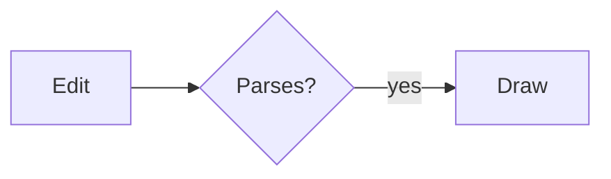

# Markdown

Open `.md`, `.markdown`, or `.mdown` files, or pipe text with `--type markdown`.
Glamour renders headings, lists, tables, and syntax-highlighted code. Local
Markdown image references (including reference-style links) use the existing
raster and SVG renderers, shown as block figures following their text line.
Paths resolve relative to the Markdown file, or the working directory for stdin.
Missing and remote images show placeholders. README HTML images (``),
including `<a>` links inside `<p>` or `<div>`, use the same local-image and GIF
playback path as Markdown images. Relative paths resolve beside the Markdown
file. Numeric `width` and `height` (1–4096 pixels) bound the image without
stretching; `align="left|center|right"` on the image or wrapper positions it.
Terminal text rounds sizes to cells and retains its inline-image height limit.
CSS, event handlers, `srcset`, scripts, and remote/data images are not enabled.
This is an image subset, not general HTML layout; source view retains the markup.

Emoji shortcodes such as `:heart:`, `:fire:`, and `:+1:` expand to Unicode in
rendered Markdown, including headings, tables, and link labels. Source view,
code, escaped shortcodes, and link destinations stay literal. Unknown names and
GitHub image-only aliases such as `:shipit:` also stay literal; no emoji images
are fetched. Search for the emoji in rendered mode or the shortcode in source
mode. Typeset mode expands shortcodes too, but its embedded fonts still lack
emoji glyphs; use normal terminal text mode to see them.

Footnotes (`[^name]` and `[^name]: explanation`) use numbered references and a
**Footnotes** section in both normal and typeset views. Repeated references share
a number; note bodies retain paragraphs, lists, code, links, and local images.
Click a reference to jump to its note. Each note starts with a **back** link;
repeated references have numbered back links to their individual occurrences.
These jumps work in both views, without opening a browser. Dragging or
Shift/Alt-clicking does not activate a jump. `/` can also find a reference or
note text. Source view and `--text` preserve the original Markdown.

GitHub alerts use a standalone `> [!NOTE]`, `> [!TIP]`, `> [!IMPORTANT]`,
`> [!WARNING]`, or `> [!CAUTION]` on the first line of a quote. Both views show
a bold label and indented callout using the current theme, preserving the
formatted body. Unknown markers and markers in code remain literal. Try
`gloss examples/markdown-extensions.md` and press `t` to compare the two views.

```sh
gloss examples/readme.md
gloss --preview examples/readme.md examples/shapes.svg
cat README.md | gloss --type markdown -
```

Use `j`/`k`, arrows, or the mouse wheel to scroll; `Space`/`b` page down/up;
`Ctrl-D`/`Ctrl-U` move half a page; `Home`/`End` jump to the ends. Press `s` to
switch between rendered Markdown and source. File navigation remains `[`/`]`.
In the native terminal viewer, click an HTTP(S) link or linked picture to open
it in your default browser, in normal or typeset Markdown. Wheel scrolling
still works. Opening a link does not download it into gloss and does not require
`--fetch`. Dragging does not activate links. Relative file links, heading anchors,
and other URL schemes are not handled by this click action.

Hover over a typeset link to preview its URL in the status bar. Moving away,
scrolling, or pressing a key restores the usual status. This requires a terminal
that reports mouse movement without a held button; normal text keeps the
terminal's own OSC 8 hover behavior.

Normal Markdown also retains OSC 8 links for the terminal's own opener. With
mouse reporting enabled, your terminal may require a modifier: Kitty supports
Shift-click or Ctrl-Shift-click. The browser demo and `--serve` do not launch a
browser on the server machine; normal-view links there use the hosting
terminal's link handling. Typeset browser-host link activation is not implemented.

Documents are limited to 2 MiB of UTF-8 and 32 image references, with a combined
16-megapixel decoded image budget after resizing. Embedded images fit within
1600 pixels, with at most 128 MiB of combined encoded image input. The default
text mode does not export a whole Markdown page as PNG. When a GIF is visible,
`e` exports the first visible GIF’s displayed full frame.

## Embedded GIFs

Local GIF figures play automatically in both views, honoring frame delays,
transparency, disposal and loop counts. Only visible GIFs run. Scrolling them
offscreen, opening help or the file menu, suspending, or switching to source
pauses playback; returning resumes at the saved position. `r`/`R` reloads and
restarts. The standalone GIF pause, speed and scrubber controls do not apply:
Space still scrolls Markdown. Typeset scrolling and reflow preserve playback
positions, and `e` exports the displayed viewport, including its GIF frames.
With Kitty graphics a typeset GIF is redrawn in its own area only, so the rest
of the page is not resent for every frame, and it stands still during a scroll
or resize burst, resuming once the view settles.

A document can animate up to eight distinct GIF or animated WebP destinations
with a combined 64 MiB of animation storage, checked before full decoding: a
GIF's decoded frames, or a WebP's RGBA canvas plus its retained compressed container.
Duplicate references share decoded frames. Animations beyond either budget keep
their first frame; `i` reports the animated and over-budget counts. Each
animation also has the usual 32 MP canvas and 1,000-frame limits. Previews and
headless exports always use the first frame. APNG remains unsupported.

## Mermaid diagrams

A fenced code block tagged `mermaid` is drawn as a diagram, shown as a block
figure in both views, like a local image. Diagrams are laid out and drawn in
pure Go by [go-mermaid](https://github.com/zkrebbekx/go-mermaid), with no
browser, JavaScript or network: flowcharts, sequence, class, state,
entity-relationship, pie, Gantt, journey, timeline, mindmap, Git graph, C4 and
other diagram types. Layout follows go-mermaid's, so diagrams can differ in
detail from Mermaid's own renderer.

````markdown

````

Diagrams use go-mermaid's light palette with a light theme and its dark palette
with a dark one, each on its own page. Changing the theme between light and dark
draws them again, keeping your place; in the theme picker (`T`) that happens
once you press Enter, not while you look through themes; headless exports follow `--theme` (auto is
light). Each diagram's source is limited to
64 KiB, and drawing runs in the parser worker under its 15-second deadline.
A diagram counts as an image reference and against the decoded-pixel budget;
the same source repeated is drawn once. A diagram that does not parse shows its
error in terminal text; typeset shows a note and the diagram's source as code.
Source view (`s`) shows the fence, and search finds its source there, not text
inside a drawn diagram.

## Typeset text and Markdown

Press `t` to switch between Glamour text and typeset Markdown, including from
source view. Switching starts at the top and clears search; the choice applies
to subsequent Markdown, plain text, source and JSON files in the viewer. `s` still toggles source.
`gloss view --typeset notes.md` chooses the initial mode (`view` is
optional). `--markdown typeset` remains a compatibility alias. Glamour remains the default. `--type markdown` and stdin work too;
converted Word, HTML, and notebooks keep their existing text renderer.

Plain text also supports `--typeset` and `t`. It uses a proportional font,
preserves line breaks and blank lines, and wraps long lines. Markdown punctuation
stays literal. Source files use monospace with Chroma highlighting; JSON uses
the existing pretty-printed representation. Tabs display as four spaces.
`s` and `/` open the normal text view without generated Markdown fences.
Converted Word, HTML and notebooks are not included in this mode.

```sh
gloss --typeset notes.txt
gloss --typeset main.go
gloss --typeset data.json
cat notes.txt | gloss --type text --typeset -
gloss --typeset -N main.go
```

Text, source and JSON are laid out one line per block, so `#` adds a gutter
of file line numbers to the page and `:` scrolls a line to the top; the status
bar shows the line at the top. `--line-numbers` (`-N`) starts with the gutter on, in
the viewer and in exports. `S` lays each line on one row instead of wrapping
it, and `←`/`→` pan across the widest line; `--chop-long-lines` (`-S`) starts
that way. A Markdown page's blocks are not lines, so there the keys point at
the source view, which has all three.

Text and JSON keep their original `kind` in export manifests. Typeset text
requires valid UTF-8, at most 2 MiB of source and formatted text, and at most
8,192 lines; the existing bounded source view must also fit without truncation.
The per-line shaping, raster and total layout limits below also apply.

Typeset Markdown uses Goldmark, go-text shaping and rasterization, repo-embedded
paired font subsets, and theme-selected Chroma syntax colors. No PDF is generated and PDFium is
not involved. The existing picture component displays one viewport image using
Kitty graphics or colored half-blocks. No terminal text/image layering is needed.
In Kitty mode, scrolling and page changes keep the previous image visible until
the next image is ready, without briefly switching to half-blocks.

The reading width follows the terminal's cell-pixel geometry, bounded to
192–960 points at a 150-DPI reading scale. With Kitty graphics the view is
drawn at the terminal's own pixel size, so high-density and wide terminals get
sharper text rather than an enlarged picture. Width changes reflow after a 30 ms
pause; the previous view stays visible while a cancellable job prepares its
replacement. Reflow anchors the current block where possible. Height changes
and scrolling reuse the layout and decoded images. Preparation validates all
source and assets; layout then advances through blocks as needed for the
viewport. A large paragraph or table still needs to finish before it appears.
Reload with `R` after editing the source or its pictures.

| Key | Typeset mode |
| --- | --- |
| `t` | Switch to normal terminal text |
| `s` | Toggle the typeset view and plain Markdown source |
| `#` | Show or hide file line numbers, where rows are file lines: text, source, JSON and Markdown source |
| `:` | Go to a line by number; `Enter` goes, `Esc` cancels |
| `S` | Chop long lines at the right edge instead of wrapping them, and back; arrows scroll sideways |
| Up / Down, wheel | Scroll vertically |
| Space / `b`, PageDown / PageUp, `n` / `p` | Scroll one screen |
| `+` / `-`, Left / Right | Zoom / pan horizontally |
| Home, `0` | Fit width and return to the top |
| `f` | Preview font pairs; Enter keeps, Esc restores |
| `T` | Preview color themes; Enter keeps, Esc restores |
| End / `G` | Lay out the remaining document and go to the bottom |
| `/` | Open source view and search Markdown text |
| `e` | Export the visible rendered viewport as PNG |
| Drag | Select text; Shift-drag is the terminal's own selection |
| `y` | Copy the selected text to the clipboard |
| `Esc` | Clear the selection |

Search currently uses the source viewer's matches and highlights; it does not
highlight text on the typeset image. `s` returns from source to the typeset view.

The page is a picture, so the terminal cannot select text from it. Drag over
it instead: the text between the two ends is highlighted, and `y` copies it,
through the terminal's clipboard (OSC 52), as the rendered text in reading
order, with a line break between paragraphs, a blank line between blocks and
a tab between table cells. Visual wrapping adds no spaces to URLs or identifiers.
Each end of the selection is a place in the text,
so it keeps through scrolling, zooming and reflowing; `Esc`, a click, or
another drag clears it, as does leaving the file. The highlight is part of
the picture, so `e` exports it too.

```sh
gloss --typeset examples/typeset.md
gloss --typeset --page 2 --dpi 200 notes.md
gloss --typeset --page all --output-dir pages notes.md
cat notes.md | gloss --type markdown --typeset --output page.png -
```

Headless exports and file-list previews use a fixed 800-pixel reading width at
150 DPI. `--page` selects numbered 1125-pixel-high slices of the continuous
layout, not paper pages: a slice boundary can cut a line or image. `--page all`
exports every slice, so headless export computes the complete layout first.
`--dpi` changes raster detail without changing line wrapping; `--max-edge`
controls the exported PNG dimensions. In the viewer `--page 2` starts at the
second slice's position. Interactive `e` saves the currently displayed viewport,
including zoom. `--output` produces PNG, never PDF; `--text` still returns the
original Markdown. Export results use `kind: "markdown"`.

Local images resolve relative to the Markdown file, or cwd for stdin. Missing,
unsupported and remote images become placeholders; no images or fonts are
fetched. An image alone in a paragraph, including one wrapped in a link, becomes an image
block and is composited into the page. Embedded GIF blocks animate; inline images
currently appear as labels. Tables have simple proportional columns, without
alignment-aware or full browser table layout. GFM strikethrough and task markers
are supported. Mermaid fences are drawn as diagrams (see above); other raw
HTML and math have no layout. Unknown or untagged
code blocks stay plain monospace. Complex-script layout, CJK/emoji font coverage,
and bidirectional text are not guaranteed.

Before decoding images: source must be UTF-8 and at most 2 MiB, with at most
32 image references (including duplicates), 16 Mi decoded pixels before resizing,
and 128 MiB combined encoded image input. SVGs reserve 1600×1600 pixels each;
duplicate destinations reuse the same decoded image. Further bounds are 32,768
AST nodes/blocks, 16,384 runes per text paragraph or code line, 8,192 lines per
code block, 262,144 laid-out glyphs, 32,768 drawing operations, and 10,000 export
slices. The shaping cache has a 32 MiB estimated-entry budget, and the cache of
rendered glyph masks another 32 MiB. Layout jobs have a
15-second deadline, and accumulated layout work is also capped at 15 seconds.
Each raster is limited to 32 Mi pixels. Exceeding a limit reports an error;
the viewer keeps the previous image if a reflow or scroll fails.


## Themes

`--theme auto|light|dark|NAME|FILE.json` applies to normal terminal text and typeset Markdown,
plain text, source and JSON. Palettes coordinate page backgrounds, body
text, headings, quotes, borders, table headers, code blocks and syntax colors.

Auto is the default. In the viewer, gloss asks the terminal for its background
color asynchronously and chooses a light or dark palette. It starts with dark
and keeps that fallback if the terminal does not answer. It uses terminal
colors, not the operating system's appearance setting. Auto rechecks on focus
when the terminal supports focus reporting; subsequent background-color replies
also update the view. Use an explicit theme when detection is unavailable,
including through a multiplexer that does not forward the reply.

Headless exports never probe the terminal: auto uses light, and
`--theme dark` explicitly exports a dark page. `--text` extraction is unchanged.

```sh
gloss --typeset --theme dark examples/typeset.md
gloss --theme light main.go
gloss --typeset --theme dark --output code.png main.go
```

Theme changes preserve the typeset scroll position, fonts, shaped text, layout
and decoded images; only the viewport is repainted. Syntax uses the same font
styles across palettes to keep line wrapping stable. The previous Kitty image
stays visible until the replacement is ready. Embedded images and existing PDF
pages are never recolored. Transparent images naturally show the page color
behind them. QR codes retain opaque black modules on white. Custom palettes
are described below; detection follows the terminal, not OS appearance.

### Named themes and customization

Press `T` over a document to preview themes using the arrow keys. Enter keeps
and, in the native viewer, saves the choice; Esc restores the previous theme.
The document behind the chooser previews the colors. Fonts and spacing stay
unchanged. Browser/serve choices last only for that viewer session.

Built-ins: light, dark, Catppuccin Latte/Mocha, Dracula, Gruvbox Light/Dark,
Monokai, Nord, One Dark, Rosé Pine, Solarized Light/Dark, and Tokyo Night.
CLI names are lowercase and hyphenated, such as `catppuccin-mocha`, `one-dark`,
and `rose-pine`. `auto` continues to follow terminal light/dark detection.

```sh
gloss --theme nord README.md
gloss --typeset --theme catppuccin-mocha README.md
gloss --typeset --theme ./my-theme.json --output page.png README.md
```

Explicit `--theme` wins over the saved native preference. Headless exports
always ignore that preference: the default remains automatic light.
Native preferences live under the OS user-config directory in `gloss/theme`
(`~/Library/Application Support/gloss` on macOS; `$XDG_CONFIG_HOME/gloss` or
`~/.config/gloss` on Linux; `%AppData%\gloss` on Windows).

Place custom JSON files in that directory's `themes` subdirectory to include
them in the chooser, or pass a file directly. Built-in names take precedence;
use an explicit path to load a same-named user file. For example:

```json
{
  "name": "my-theme",
  "base": "dark",
  "syntax": "nord",
  "background": "#20242b",
  "foreground": "#eceff4",
  "accent": "#88c0d0"
}
```

`base` must be `light` or `dark`. Missing colors inherit from that base.
Optional colors are `background`, `foreground`, `muted`, `border`, `code`,
`header`, `accent`, and `selection`; each must be `#RRGGBB`. `syntax` names a
bundled Chroma style and defaults to GitHub light/dark. Unknown fields and
invalid values are errors. Names use lowercase letters, digits, and hyphens
(up to 64 characters). Files are limited to 64 KiB; the chooser reads at most
64 user files and omits malformed files. Selecting a malformed file explicitly
reports its error. Accepted choices save a snapshot; restart and select the
file again to pick up edits. No assets are downloaded.

The palette colors the pager's status, prompts, document overlays, normal text,
and typeset pages. Media pixels and mesh paints retain their own colors.
This does not change your terminal application's configured palette or font.

## Typeset font looks

Press `f` while viewing typeset Markdown, text, source, or JSON. The chooser
shows four paired looks using a line from the open document and a code line
when it finds a fenced code block. Names and samples are drawn in the actual
faces. Arrows preview the selection in the document behind it; Enter keeps it,
Esc restores the previous pair. `+`/`-` still zoom; `0` still resets the view.
Small terminals fall back to a text list. Sample images use Kitty when available
and half-blocks otherwise. `f` retains fit behavior for other media.

| Look | Body | Code |
| --- | --- | --- |
| `readable` (default) | Literata | Iosevka |
| `editorial` | Newsreader | Iosevka |
| `technical` | IBM Plex Sans | IBM Plex Mono |
| `compact` | Source Serif 4 | JetBrains Mono |

```sh
gloss --typeset --font editorial README.md
gloss --typeset --font technical --mono jetbrains main.go
gloss --typeset --font compact --output page.png README.md
```

`--mono jetbrains` overrides the code face of the pair, including its chooser
samples. The UI selects pairs, not individual faces. `i` shows the real family
names, any fallback families used, and up to 32 missing code points encountered
in the text laid out so far. Missing body glyphs try Literata; missing code
glyphs try Iosevka. Characters absent from both remain missing, not silently
substituted with an unrelated font.

The native viewer remembers confirmed choices in `gloss/font` under the OS
user-config directory. Either explicit font flag overrides the saved pair.
Browser choices are session-only. Exports ignore saved preferences and default
to Readable; pass the flags for reproducible output.

The embedded subsets include Latin/Latin-1, combining accents, and common
punctuation, with regular/bold/italic/bold-italic faces. Optional ligatures are
disabled. CJK, emoji, and block-drawing glyphs are not included. Use normal
terminal text mode for these; their appearance depends on the terminal's fonts
and Unicode support. There is no font download, system-font
lookup, PDF intermediate, or change to the terminal's font. Font changes reflow
while anchoring the visible block; resizing and color changes reuse loaded
faces. `s` and `/` continue to work on the normal text/source view.
