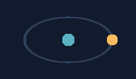
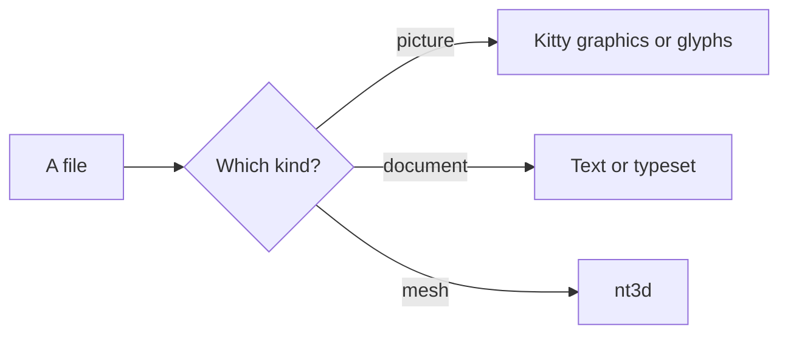

# A visual pager

Gloss renders **Markdown with Glamour**, including local raster images and SVGs.
Use `j` / `k` to scroll, `s` to toggle source, and `t` to switch text/typeset.
Press `m` for the file menu.

## Linked GIFs: Markdown and HTML

Both figures use the same original local GIF. They animate while visible in the
viewer; menu previews and headless PNG exports show the first frame. Click either figure
to visit the gloss repository.

### Markdown image

[](https://github.com/NimbleTerminal/gloss)

### HTML image

This version uses a centered paragraph and a 160-pixel width bound. It keeps the
same aspect ratio and resolves the image beside this file.

<p align="center">
  <a href="https://github.com/NimbleTerminal/gloss">
    
  </a>
</p>

Press `t` to compare both renderers, or `s` to inspect the markup. Scroll away
and back to check that visible GIF playback resumes.

## An embedded SVG


## Raster images

Open `motion.gif` or `motion.webp` from the gallery for an animated orbit; Space
pauses or resumes it. The WebP is the same orbit, converted losslessly, and
plays here as an embedded animation too:



Two original landscapes, decoded locally: blue hills at dusk in PNG and a sunny desert in HEIC.


## A diagram

A fenced `mermaid` block is drawn as a diagram in both views, in pure Go:



## A small table

| Input | Rendering |
| --- | --- |
| Markdown | Glamour |
| SVG | ntsvg |
| Mermaid | go-mermaid |
| STL | nt3d |

```sh
gloss --preview examples/readme.md examples/shapes.svg examples/gloss.stl
```

Remote images are shown as placeholders; local paths resolve beside this file.

## A word in three dimensions

Open `gloss.stl` to orbit GLOSS built from raised blocks. Arrow keys rotate,
`r` toggles auto-rotation, and `0` resets the camera.
